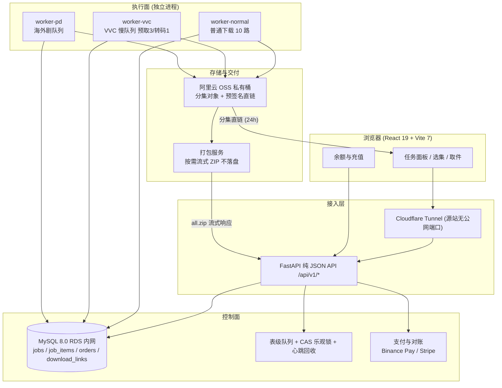

# 红果短剧云端交付系统 (parallelpan / hongguo-downloader) 架构与设计分析

> **核对提示（2026-11-07）**：该仓库公开的是**架构、交付链路与工程实践文档，不含可执行源码**。本文内容全部来自其公开 README、架构图与案例自述，**未经源码或运行时逐项验证**；文中的性能数字（85 秒、114 秒、75 秒等）为对方单方陈述，没有对照测试支持。请勿把本文当作实现细节的准确描述。

> 本文档为参考架构解析文档，梳理第三方项目 [`parallelpan/hongguo-downloader`](https://github.com/parallelpan/hongguo-downloader)（文档与截图 CC BY-NC 4.0；线上服务按取件集数计费）在**长任务编排、按需流式打包、单机自愈**上的设计取舍，作为本项目下载队列与导出链路的参考资料。本文仅作技术交流，不构成对该服务的使用推荐；该项目为第三方非官方项目，不提供可执行代码与内容获取工具，与红果、字节跳动及其关联公司无关联。

---

## 1. 产品概述与核心定位

| 项 | 内容 |
|---|---|
| 形态 | B/S 云端服务（浏览器提交任务、云端处理、取件下载），**非桌面客户端** |
| 输入 | 一部剧或任意一集的分享链接 |
| 输出 | 分集预签名直链，或按需生成的整剧 `all.zip`（支持 Range / 断点续传） |
| 计费 | 按实际取件集数计费，不做会员制 |
| 公开材料 | 架构图、交付链路文档、界面截图、生产案例与 FAQ；**无源码** |
| 与本项目差异 | 本项目是 Electron 本地播放 + 本地 FFmpeg 合并；该系统把下载、校验、打包全部放在云端，客户端只是一个任务面板 |

这个形态差异决定了后面所有设计：本地工具关心「单集怎么解密、怎么合并」，云端服务关心「上千个任务项怎么排、失败怎么恢复、几 GB 的包怎么在不落盘的前提下发出去」。它并不解决播放体验问题，也没有 WebGPU 画质增强之类的客户端能力。

**按集计费是产品决策，也是架构约束**：带宽、存储、设备占用都随集数线性增长，会员制会让「下 10 集」和「下 1000 集」付同样的钱，最终只能靠限速平衡。按集计费要求「取件」这个动作必须可计量、可幂等、可重复签发，这直接催生了第 5 节的直链签发分离与唯一键设计。

---

## 2. 全景架构与技术选型

### 2.1 全景架构拓扑



### 2.2 技术选型清单

| 层 | 选型（据公开文档） |
|---|---|
| 前端 | React 19 · Vite 7 · TypeScript · TanStack Query · 自建设计令牌（深色前台 / 浅色后台） |
| 后端 | FastAPI · SQLAlchemy · Pydantic · 纯 JSON API |
| 数据 | 开发 SQLite / 生产 MySQL 8.0（RDS，仅内网） |
| 存储 | 阿里云 OSS 私有桶 + 预签名直链（支持 Range），可降级本地磁盘 |
| 任务 | 独立 worker 进程 + 表级队列 + CAS 乐观锁 + 心跳回收 |
| 支付 | Binance Pay（只读 API 拉流水对账）· Stripe Checkout + Webhook |
| 部署 | 自定义镜像 + 伸缩组自愈（MIN=MAX=1）+ Cloudflare Tunnel（无公网入口） |
| 质量 | 接口冒烟测试 + Playwright 真实浏览器 e2e（文档自述不 mock 接口、不注入登录态） |

值得注意的是**没有 Redis / MQ、没有 K8s、没有对象存储之外的中间件**。对单人维护的长任务服务，这是一个刻意的「少一个组件就少一类故障」取舍，代价是队列能力受关系型数据库上限约束，横向扩展 worker 需要靠 CAS 抢占而非分区消费。

---

## 3. 表级队列与长任务编排

公开文档描述的队列模型有四条规定：

1. **任务表即队列**：`jobs` 是任务、`job_items` 是分集任务项，状态机在表里，不引外部 MQ；
2. **CAS 乐观锁抢占**：worker 用带状态条件的更新语句接单，避免多个进程领到同一项；
3. **心跳超时回收**：worker 被杀掉后，跑到一半的任务靠超时重置回 pending，重启后跳过已完成集；
4. **按 codec 分流**：普通下载走 `worker-normal`（10 路并发），VVC 转码因为单集 x265 重编码约 253 秒，单独走 `worker-vvc`（预取 3、转码 1），路由靠 `job_items.codec=bytevc2` 的 EXISTS/NOT EXISTS 条件 + CAS；漏检由取单逻辑兜底。

第 4 条对本地桌面下载器最有借鉴意义：**把「慢且重」的任务从常规并发池里摘出来**，否则一个 4 分钟的转码项会长时间占住本可服务普通下载的槽位。桌面端常见的「全局并发数」配置其实可以用同样的思路拆成两个池。

文档还记录了一个与会话缓存有关的事故：手工把某个 `job_items` 置为成功，但正在运行的 worker 因为 ORM 身份映射缓存仍按旧状态过滤，收尾时没把这个文件收进结果；而进度统计走 COUNT 查询显示全绿，**面板正常、分集链接 404**。结论是手工补数据必须同时补齐「文件 + 任务项状态 + 对象存储里的对象」三样，判据只能是对象是否存在。这类「读路径与写路径口径不一致」的问题，在任何带本地缓存的下载队列里都容易复现。

---

## 4. 下载与打包解耦：按需流式 ZIP

这是该系统最核心的一条设计，也是和「下完再合并」的桌面工具差别最大的地方。

### 4.1 1000 集案例

| 项 | 自述数值 |
|---|---|
| 分集文件 | `ep-001.mp4` … `ep-1000.mp4`，单集约 13.9 MB |
| 传输 | OSS 内网 endpoint，不产生公网流量费 |
| 下载阶段 | 约 85 秒后任务即置「已完成」，用户可立即按集取件 |
| 整包 | 仅在用户点击时按需生成 `all.zip`，不占 worker、不阻塞后续任务 |
| 整包基准 | 888 集 / 4.26 GB 约 114 秒 |

**下载完成 ≠ 整包就绪**：状态机只承诺分集可用，整包是另一个按需计算。这样长剧不必等最后一份字节落盘才能开始交付，用户也不需要为「可能根本不会点」的整包付等待成本。

### 4.2 流式 ZIP 的两个坑

- **连接必须惰性打开**：最初在生成器里对每个对象直接 `get_object`，一次开近 900 条连接，被 OSS 判为空闲关掉，报 `IncompleteRead`。改成同一时刻只打开 1 条对象流，逐段 yield，断读按已读字节续传（最多 3 次；400/404 不重试）。
- **打包前逐集核对**：库里标记成功但对象缺失的集回退为失败，宁可报错也不打出残缺包。

对本地工具而言，等价的启示是「合并动作与下载动作可以不同步」：下载队列只保证分集完整落盘，合并/导出作为独立按需任务，且合并前必须重新 stat 每个文件而不是相信内存里的状态表。

---

## 5. 支付、幂等与直链签发

```
币安 Pay：下单 → 唯一金额 + 备注码 → 用户转账
          → 收银台每 3 秒查单，服务端顺带拉官方流水
          → 唯一金额命中 / 备注码命中 / 回填订单号，三选一即入账

Stripe：  下单 → 建 Checkout session（metadata 带 order_id）→ 跳转付款
          → webhook 只做唤醒，入账以官方 retrieve 为准
```

四条口径值得单独记下来：

1. **入账 = 实付**：币安流水实际到账多少就记多少，识别尾差不是手续费，绝不按面额截留；
2. **回调不盲信**：webhook 只用于提速，验签失败返 400，未配置签名密钥直接 503 而非降级成「盲信模式」；
3. **扣费在取件，不在建任务**：用户先看到「能下成」再付钱，`download_links.job_id` 唯一键兜住并发重复扣费；
4. **直链签发分离**：存储层只做预签名，链接有效期 24 小时，过期重取不重复扣费。

后台的「自动确认率」被当作这条链路的体检指标（自述正常 80%+），一掉就说明对账在退化、需要人工介入。把业务指标直接绑在支付链路上，比事后翻日志更早发现问题。

---

## 6. 单机自愈与发版纪律

生产是**单机自愈**架构：伸缩组 MIN=MAX=1 + 自定义镜像 + Cloudflare Tunnel，源站不开放任何公网端口。公开文档给出的故障演练时间线：

| 时刻 | 事件 |
|---|---|
| T+0s | 手动摘除实例，站点立即 530 |
| T+60s | 伸缩组用镜像拉起新节点，UserData 注入配置 |
| T+68s | 设备层冷启动与附着自检通过 |
| T+75s | `GET /health` 恢复 200，隧道自动重连 |

设计要点是**修复动作固化在 UserData 里**，不依赖某人记得敲过的命令，因此可复现、可演练。

与之配套的是一条容易漏的发版纪律：**发版只改磁盘不改镜像，等于没有发版**。伸缩组重建时看的是「生效伸缩配置」里的 `ImageId`，镜像不刷新，机器一被回收就回退到旧版本。文档因此把「一个 tag = 一次上线」和「镜像刷新」拆成两个独立动作，并用 `/opt/hg-site/RELEASE` 与 `/health.version` 同时等于该 tag 作为唯一验收条件。

这一节对桌面项目的参考价值偏运维而非功能，但「用健康检查 + 声明式启动脚本替代人工重启」的思路同样可用于本地常驻服务。

---

## 7. 交付质量与失败处理

公开材料里几条与可靠性相关的约定：

- **分集发布以「状态 = 成功」且「文件/对象真实存在」为准**，两者缺一不可；
- **解码校验不是交付门槛**：校验设 20 秒超时，超时后用 `-skip_loop_filter all` 再验一次，双超时才放行，且限制并发路数与线程数，避免校验本身拖垮队列；
- **混合封装要按容器实际特征判断**，不能按「有没有密钥字段」判死：上游会混发明文集，正确做法是先扫 `sinf`/`encv` 判断是否为真加密，明文直接 remux；VVC 明文流同样存在（`stsd` 为 `bvc2` 而非 `encv`），需按 `hdlr=='vide'` 选轨后转 Annex B 再解码；
- **临时故障不做降级页**：用 503 + 健康检查表达，而不是把错误页标成可索引内容。

第 2 条对本地媒体处理尤其有用：**校验是观测手段，不能成为阻塞交付的闸门**，否则一个解码器的偶发超时会让整批任务卡住。

---

## 8. 设计评析与参考借鉴价值

### 核心优势

1. **下载与打包解耦**：把最耗时、最占内存的动作从关键路径上摘掉，长剧的首次可用时间只取决于分集下载，不取决于整包生成；
2. **中间件极少**：表级队列 + CAS 就够支撑单人运维的长任务服务，没有 MQ、Redis、容器编排的运维成本；
3. **流式打包的连接治理**：惰性单连接 + 断读续传，解决了大批量小对象组装时的连接数问题，这是任何「整包导出」功能都会遇到的坑；
4. **计费与交付状态分离**：扣费发生在取件、直链可重签、唯一键防重复，业务口径清晰；
5. **修复动作声明式**：UserData + 健康检查让故障恢复可演练，而不是靠人工重启。

### 潜在短板与局限

1. **不开源、不可本地验证**：仓库只有文档与截图，所有架构描述和性能数字都无法由第三方复核（见文首核对提示）；本文只能作为设计思路参考，不能作为实现依据；
2. **强绑定单一云厂商**：OSS 内网 endpoint、预签名直链、RDS、伸缩组与自定义镜像构成一套完整但不易迁移的部署栈；
3. **单机无冗余**：MIN=MAX=1 意味着恢复期约 75 秒不可用，且队列能力上限受单实例约束；
4. **按集计费的服务形态**：与本项目「本地免费工具」的定位不同，其支付与对账部分对桌面客户端几乎没有可移植价值；
5. **版权与合规边界**：文档自述不提供内容获取工具、不分发剧集资源、版权归原平台及创作者；任何借鉴都应限于任务编排与文件交付层面的通用工程方法。

---

> 参考来源：[parallelpan/hongguo-downloader](https://github.com/parallelpan/hongguo-downloader) 公开 README、架构图与案例文档（CC BY-NC 4.0）。本文为第三方研究笔记，转载请保留原始出处与上述核对提示。
