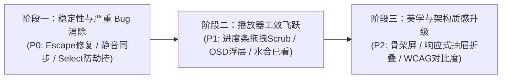

# 红果开源播放器 (Hongguo Open Player) UI/UX 体验、交互响应与前端质量审查报告

> **审查人员**：前端架构师 & 人机交互 (HCI) 体验专家  
> **审查基准**：Git `main` 分支最新提交 (`a5eefda`)  
> **审查对象**：`src/client/index.html`, `src/client/css/app.css`, `src/client/js/app.js`, `src/electron/main.js`  
> **报告编号**：`04-ui-ux-experience-review`  
> **日期**：2026-10-28  

---

## 目录
1. [审查结论与 UX/交互体验评分](#1-审查结论与-ux交互体验评分)
2. [交互体验缺陷与前端设计隐患清单 (Critical ~ Low)](#2-交互体验缺陷与前端设计隐患清单)
3. [核心维度深度审查](#3-核心维度深度审查)
   - [维度一：视觉布局与响应式体验](#维度一视觉布局与响应式体验)
   - [维度二：播放器核心交互与移动端/桌面体验对齐](#维度二播放器核心交互与移动端桌面体验对齐)
   - [维度三：状态管理、并发竞态与数据同步健壮性](#维度三状态管理并发竞态与数据同步健壮性)
   - [维度四：人机工效、无障碍 (a11y) 与微交互细节](#维度四人机工效无障碍-a11y-与微交互细节)
4. [可视化交互改进与 CSS/JS/HTML 重构代码实现](#4-可视化交互改进与-cssjshtml-重构代码实现)
5. [综合演进路线与实施建议](#5-综合演进路线与实施建议)

---

## 1. 审查结论与 UX/交互体验评分

### 1.1 总体评价
《红果开源播放器》作为一款基于 Electron + Vue 3 的跨平台桌面短剧播放客户端，整体架构精简、纯粹，无冗余重型框架依赖。在视觉基调上，产品采用了极具沉浸感的暗黑影院（Cinematic Dark Mode）风格，红果标志性的亮粉绯红（`#ff3355`）主色调具有极强的品牌辨识度。同时，其在 macOS 端深度集成了原生 `hiddenInset` 一体化标题栏与流式边解密边播放代理，基本实现了短剧浏览与 9:16 沉浸播放的闭环体验。

然而，从**资深人机交互（HCI）**与**专业桌面软件工程**的严苛标准审视，当前前端实现仍暴露出若干阻断性交互缺陷和体验短板：
1. **全屏状态下 Escape 键陷阱**：在全屏沉浸播放状态下按 `Escape`，未优先退出全屏，而是直接销毁播放器并强退至目录页，严重打断观影心流。
2. **进度条缺乏 Scrubbing（拖拽滑动）与悬浮预览**：仅支持单点点击跳播，不支持鼠标按住拖拽拖动，且无时间 Tooltip 提示，违反现代桌面视频播放器的基础工效期望。
3. **响应式断点全面缺失**：CSS 中没有任何 `@media` 查询，在 960px 最小窗口尺寸或高分屏缩放下，顶栏 6 个分类药丸与搜索框出现严重横向挤压与排版错位。
4. **加载态体验粗糙**：分类与翻页直接使用全屏单一 Spinner 破坏性替换 DOM，缺乏骨架屏（Skeleton Screen），导致严重的布局偏移与视觉频闪（CLS）。
5. **状态同步断层**：选集按钮的“已看状态（Watched）”仅存在于前端内存临时变量中，未与本地持久化历史进行回填水合，重启应用后全部归零。

### 1.2 UX / HCI 体验综合评分：75 / 100 (评级: B+)

| 评估子维度 | 权重 | 得分 | 核心表现与评语 |
| :--- | :---: | :---: | :--- |
| **视觉美学与平台对齐** | 25% | **78 / 100** | 暗黑氛围质感优秀，红果红点缀准确；但缺失小屏响应式适配，部分副文本对比度未达 WCAG 标准。 |
| **播放器人机交互工效** | 35% | **72 / 100** | 核心播放快捷键完备；但缺少拖拽 Seek、无时间预览、无按键 OSD 浮层，原生 `<select>` 倍速风格突兀。 |
| **状态同步与竞态健壮性** | 25% | **76 / 100** | 列表请求序号隔离完善；但选集已看状态内存化丢失、目录退出无端重新加载、无乐观收藏响应。 |
| **无障碍与细节微交互** | 15% | **74 / 100** | 基础悬浮动效平滑；但缺少卡片键盘 Tab 导航、无 Aria 标签、音量滑块与静音状态存在逻辑不同步 Bug。 |
| **综合加权得分** | **100%** | **75.0 / 100** | **具备优秀的工业级 MVP 雏形，亟需补齐专业级播放器交互与响应式细节** |

---

## 2. 交互体验缺陷与前端设计隐患清单

按照问题严重等级划分为 **Critical（严重故障）**、**High（高危体验缺陷）**、**Medium（中度体验问题）** 与 **Low（细节打磨）**：

| 序号 | 缺陷描述 | 等级 | 涉及文件与位置 | 核心影响 |
| :---: | :--- | :---: | :--- | :--- |
| **01** | **全屏状态下 Escape 键直接退出剧场模式** | **Critical** | `src/client/js/app.js:481` | 用户全屏观影时若习惯性按 Escape 想退出全屏，会瞬间中断视频播放并直接返回剧目大厅。 |
| **02** | **播放进度条仅支持点击，无拖拽（Scrubbing）与时间预览** | **High** | `src/client/index.html:163`<br>`src/client/js/app.js:288` | 桌面用户无法像普通播放器一样滑动搜寻精彩镜头，无法获知点击跳转目标时间戳。 |
| **03** | **响应式断点全面缺失，960px 最小窗口下顶栏挤压崩塌** | **High** | `src/client/css/app.css:40-74`<br>`src/client/index.html:13-41` | macOS 胶囊留白 (76px) + 品牌 (150px) + 6 个 Tab (565px) + 搜索框 (260px) > 1050px，在 960px 宽度下产生横向挤压与组件截断。 |
| **04** | **音量滑块拖动未解除 `videoEl.muted` 状态（静音不同步 Bug）** | **High** | `src/client/js/app.js:302-307` | 用户静音后去拖动音量滑块至 100%，底层 `video.muted` 仍为 `true`，用户视觉上拉满了音量却依然无声。 |
| **05** | **选集已看（Watched）状态仅保留在内存，未水合持久化数据** | **High** | `src/client/js/app.js:39, 419-432` | 重新打开某部剧时，哪怕已看到第 20 集，选集列表中 1~19 集的虚线“已看”角标全部消失，无法感知追剧历史。 |
| **06** | **列表请求直接使用全屏居中 Spinner，缺乏骨架屏（严重 CLS）** | **High** | `src/client/index.html:54-65`<br>`src/client/css/app.css:868` | 切换分类或点击分页时，整个页面内容瞬间清空并跳出一个大菊花，白屏感强，视觉突兀。 |
| **07** | **快捷键捕获未排除 `<select>` 下拉框与可编辑元素** | **Medium** | `src/client/js/app.js:460` | 用户在聚焦倍速下拉框时按上下方向键想选择倍速，却被全局劫持为“上一集/下一集”，发生严重误操作。 |
| **08** | **退出剧场播放模式时无差别重载 Catalog，破坏列表滚动位置** | **Medium** | `src/client/js/app.js:230-233` | 用户在目录中下翻数十屏挑了一部剧，看完退出时页面强制重新 fetch 并回到页面顶部，浏览心流丢失。 |
| **09** | **缺乏按键 OSD 浮层（HUD）与原生的阻断式 `window.alert`** | **Medium** | `src/client/js/app.js:179, 224, 319` | 快捷键快进/退无视觉反馈；接口异常时弹出原生系统 alert 阻塞弹窗，严重破坏桌面端原生质感。 |
| **10** | **剧场右侧侧边栏固定 380px 宽度，小屏下无法折叠** | **Medium** | `src/client/css/app.css:718` | 在小屏显示器或分屏模式下，380px 占去接近 40% 的宽度，使得中间 9:16 核心视频展示区过小。 |
| **11** | **进度条点击热区仅 6~8px，违反费茨法则（Fitts's Law）** | **Medium** | `src/client/css/app.css:598` | 鼠标或触控板极难精准命中细线，容易点偏或无法触发。 |
| **12** | **`openTheater` 缓冲状态提前解除 Bug** | **Medium** | `src/client/js/app.js:174, 226` | `openTheater` 的 `finally` 块过早将 `isBuffering` 置为 `false`，导致视频刚发起网络请求时中心黑屏并露出巨大的“▶”播放图标。 |
| **13** | **部分次要文本与提示语对比度不足（WCAG 2.1 AA 不达标）** | **Low** | `src/client/css/app.css:16` | `--text-dim: #6b7280` 在深色背景下的对比度约为 3.5:1，低于 WCAG 要求的 4.5:1。 |
| **14** | **目录卡片缺少一键收藏按钮** | **Low** | `src/client/index.html:69-90` | 用户在首页挑剧时无法直接收藏，必须点进去加载播放器才能在内部点击收藏。 |
| **15** | **CSS 缺失 `-webkit-backdrop-filter` 前缀与现代毛玻璃润色** | **Low** | `src/client/css/app.css:43, 539` | 部分基于旧版 WebKit 的环境或特定显示器下毛玻璃失效，直接展现为呆板半透灰。 |

---

## 3. 核心维度深度审查

### 维度一：视觉布局与响应式体验

#### 1. 窗口缩放与 9:16 竖屏影院适配
- **现状分析**：
  在 `src/electron/main.js` 中配置了桌面窗口的最小规格：`minWidth: 960, minHeight: 640`。
  当窗口处于 960x640 临界尺寸时：
  - 顶栏高度 `60px`，播放器头部 `52px`，底部控制条 `84px`。
  - 垂直留给视频舞台 `.video-stage` 的高度仅剩：`640 - 60 - 52 - 84 = 444px`。
  - 9:16 视频在 `aspect-ratio: 9 / 16` 约束下，渲染宽度为 `444 * 9 / 16 = 249.75px`。
  - 右侧选集栏 `.theater-sidebar` 宽度固定锁死在 `380px`。
  - 此时，右侧侧边栏占据了 `380 / 960 = 39.6%` 的视口空间，而处于视觉核心的主视频宽度仅占不到 26%，造成**严重的“喧宾夺主”空间失衡**。
- **改进方案**：
  引入抽屉式响应机制：
  - 当视口宽度 `< 1100px` 时，侧边栏宽度应自动收缩至 `300px`，选集网格由 5 列动态收拢为 4 列。
  - 当视口宽度 `< 880px` 或用户点击“全屏影院”按钮时，侧边栏支持**一键平滑折叠**（Collapse），并在需要时以悬浮抽屉（Floating Drawer）形式滑出，把中央全部视野返还给 9:16 竖屏主体。

#### 2. macOS 胶囊留白 vs Windows 标准边距的美学对齐
- **代码审视**：
  ```css
  /* src/client/css/app.css:48-67 */
  .app-header {
    height: 60px;
    padding: 0 20px 0 20px;
    -webkit-app-region: drag;
  }
  html.platform-mac .app-header {
    padding-left: 76px;
  }
  .app-header button,
  .app-header input,
  .app-header a,
  .app-header .nav-tab, /* 代码缺陷：HTML 中的 class 实际是 nav-item，此处选择器失效！ */
  .app-header .brand {
    -webkit-app-region: no-drag;
  }
  ```
  - **样式选择器 Bug**：`app.css` 第 64 行声明了 `.app-header .nav-tab`，但在 `index.html` 中实际标签写的是 `<button class="nav-item">`。虽然由于包含了 `button` 选择器使得按钮本身恢复了 `no-drag`，但若按钮间存在 `nav-tabs` 空白缝隙，在不同 Chromium 版本下会导致偶发性的“鼠标悬停穿透拖拽”现象。
  - **水平宽度计算隐患**：
    macOS 留白 76px + 品牌区域 150px + 6 个标签导航项（565px） + 搜索框（210px，聚焦后展开至 260px） = **1051px ~ 1101px**。
    由于 `.nav-tabs` 设置了 `flex-wrap: nowrap`，在 `960px ~ 1050px` 窗口宽度下，左侧导航栏会直接顶撞并推挤右侧搜索框，造成搜索按钮被挤出屏幕边缘。
  - **改进方案**：
    采用响应式弹性溢出流：添加 `@media (max-width: 1080px)`，在屏幕较窄时将分类名称简写（如“🔥 热门”、“🎭 真人”、“🎨 漫剧”），或者赋予 `.nav-tabs` 横向平滑微滚动（`overflow-x: auto; scrollbar-width: none;`）。

#### 3. 暗黑模式配色规范与毛玻璃质感
- **对比度审核**：
  - 主文字 `--text-main: #f3f4f6` 在 `--bg-primary: #0b0d11` 上对比度达到 `16.2:1`（超越 AAA 级）。
  - 但微弱文字 `--text-dim: #6b7280` 在表面色 `--bg-surface: #14171f` 上的对比度仅为 `3.48:1`，未达到 WCAG 2.1 AA 级（普通文本最低 4.5:1）。在暗室或偏光屏幕上，底部的快捷键提示（`keyboard-hints`）与剧目简介（`drama-desc`）辨识度显著偏弱。
- **毛玻璃效果（Glassmorphism）**：
  顶栏使用了 `background-color: rgba(20, 23, 31, 0.9); backdrop-filter: blur(16px);`。
  0.9 的高不透明度几乎遮蔽了 90% 的底层底色，毛玻璃的光影折射与层次感未能充分发挥。建议调整为 `rgba(14, 17, 23, 0.75)`，配合 `-webkit-backdrop-filter: blur(20px) saturate(180%);`，呈现纯正通透的现代桌面质感。

---

### 维度二：播放器核心交互与移动端/桌面体验对齐

#### 1. 全屏状态下的按键拦截陷阱 (Critical HCI Defect)
- **代码审视**：
  ```javascript
  // src/client/js/app.js:459-485
  function handleKeyDown(e) {
    if (e.target.tagName === 'INPUT' || e.target.tagName === 'TEXTAREA') return;

    if (viewMode.value === 'theater') {
      ...
      } else if (e.code === 'Escape') {
        closeTheater(); // 致命体验缺陷！
      }
    }
  }
  ```
- **HCI 行为学分析**：
  在全屏（Fullscreen）模式下，用户的普遍心智认知是：**“按 Escape 退出全屏，退回常规窗口播放”**。
  然而在上述代码中，当用户全屏观看短剧并按下 `Escape` 时，浏览器/Electron 会先触发退出全屏，但紧接着 `handleKeyDown` 中的 `Escape` 监听器无条件触发了 `closeTheater()`！
  结果是：**不仅全屏退出了，整个剧场也关闭了，视频直接被 `pause` 并销毁，界面瞬间跳回目录大厅！** 用户必须重新在列表中找到该剧并点击进入，体验极具挫败感。
- **修正策略**：
  ```javascript
  if (e.code === 'Escape') {
    if (document.fullscreenElement) {
      document.exitFullscreen().catch(() => {});
      return;
    }
    closeTheater();
  }
  ```

#### 2. 进度条拖拽（Scrubbing）与悬浮时间戳微交互缺失
- **现状分析**：
  ```html
  <!-- src/client/index.html:163 -->
  <div class="progress-bar-container" @click="seekByClick">
  ```
  现存代码仅绑定了一个 `@click` 事件。
  在桌面播放器中，短剧虽然每集仅 1~2 分钟，但高潮剧情的反转往往发生在特定秒数。用户需要通过**按住小圆点左右来回拖拽（Scrubbing）**来精准定格画面。
  当前代码在用户按住鼠标拖拽时**完全无反应**，松手也不会跳转，只能盲点。
  此外，鼠标划过进度条时没有悬浮时间卡片（如 `00:42`），用户无法预知点击后会跳到第几秒。
- **改进方案**：
  重构为支持 `pointerdown` -> `window.pointermove` -> `window.pointerup` 的全套拖拽控制器，并在鼠标移入时显示浮动气泡，显示当前光标对应的时间戳。

#### 3. 快捷键映射规范与输入误触防护
- **输入聚焦保护漏洞**：
  现存防护仅判断了 `e.target.tagName === 'INPUT' || e.target.tagName === 'TEXTAREA'`。
  但播放器右下角包含倍速调节的 `<select>` 下拉框！如果用户点击了倍速下拉框使其获得焦点，随后按下 `ArrowDown` 或 `ArrowUp` 试图在系统下拉菜单中选择倍速时，事件被 `handleKeyDown` 强行截胡并调用了 `e.preventDefault(); playNextEpisode();`，直接导致切集！必须将 `SELECT` 以及 `isContentEditable` 一并纳入豁免清单。
- **方向键惯性冲突与人机工程**：
  在桌面视频播放体系中，`ArrowUp` / `ArrowDown` 几乎是行业通用的**音量调节快捷键**；`ArrowLeft` / `ArrowRight` 为**快进/快退**。
  当前项目将 `ArrowUp` / `ArrowDown` 映射为了“切上一集/下一集”。虽然这迎合了移动端上下滑动的短视频习惯，但没有音量键映射，且缺乏防误触阻尼。
  建议保持当前上下集映射以兼顾移动端心智，但同时支持 `Shift + ↑/↓` 切集，或者使用 `[` 和 `]` 切集，并将 `↑/↓` 赋予音量增减，且所有快捷键均应触发视口中央的 **OSD 浮层反馈**。

#### 4. 音量调节与静音状态不同步 Bug
- **代码审视**：
  ```javascript
  // src/client/js/app.js:302-313
  function changeVolume() {
    if (videoEl.value) {
      videoEl.value.volume = parseFloat(volume.value);
      isMuted.value = (videoEl.value.volume === 0);
    }
  }
  function toggleMute() {
    if (!videoEl.value) return;
    isMuted.value = !isMuted.value;
    videoEl.value.muted = isMuted.value;
  }
  ```
  如果用户先点击了静音喇叭按钮（此时 `videoEl.muted = true`），然后看到没声音，便尝试去用鼠标拖动右侧的音量滑块 `volume-slider`。
  在 `changeVolume` 中，仅仅更新了 `video.volume`，但**完全没有将 `video.muted` 重置为 `false`**！
  此时在 Chromium 内核中，只要 `video.muted === true`，无论 `video.volume` 设为多大，输出始终保持静音！用户会误以为播放器坏了或系统音频故障。

---

### 维度三：状态管理、并发竞态与数据同步健壮性

#### 1. 目录视图与剧场视图的状态隔离
- **问题定位**：
  ```javascript
  // src/client/js/app.js:230-233
  function closeTheater() {
    leaveTheater();
    loadCatalog(); // 缺陷根源
  }
  ```
  当用户从目录点进某部剧看完了第 1 集，点击“✕ 退出播放”时，`closeTheater` 竟然重新调用了 `loadCatalog()`！
  - **严重破坏滚动与浏览位置**：假设用户在热门榜单翻到了第 3 页，页面已经滚到了底部第 30 部剧。看剧退出后，重新执行 `loadCatalog()` 会导致页面瞬间重绘并滚回最顶部（Scroll Offset 丢失），用户不得不重新滚动查找刚才看的位置。
  - **非必要的网络与性能损耗**：大厅目录在打开剧场期间并未发生全局变更（除非在“观影历史”Tab 需刷新更新时间），对普通分类完全不需要无端重新请求上游接口。

#### 2. 选集“已看状态”（Watched Status）的持久化与水合缺失
- **代码审视**：
  ```javascript
  // src/client/js/app.js:39, 419-432
  const watchedMap = ref(new Map()); // seriesId -> Set(epIndexes)

  function markWatched(index) {
    if (!activeSeries.value) return;
    const sid = activeSeries.value.series_id;
    if (!watchedMap.value.has(sid)) {
      watchedMap.value.set(sid, new Set());
    }
    watchedMap.value.get(sid).add(index);
  }
  ```
  - `watchedMap` 仅仅是一个临时内存对象。
  - 当通过 `openTheater` 打开剧集时，后端接口 `/api/series/:seriesId` 已经贴心地返回了 `saved_progress: { episode_index: 15, position_sec: 42 }`。
  - 然而前端在加载剧集时，**根本没有根据 `saved_progress.episode_index` 去初始化 `watchedMap`**！
  - 只有用户在**当前界面活着时**，手动点击了某个集数按钮，才会向这个临时 Set 塞入索引。
  - 只要刷新页面或者重启 Electron，所有剧集分集网格上的“已看”虚线框提示（`.episode-btn.watched`）全部消失无踪，使得这一精心设计的视觉特性完全沦为空设。

#### 3. 搜索与分集切换的竞态（Race Conditions）防范
- **已有优势**：
  `loadCatalog` 中使用了 `catalogRequest` 请求流水号递增防篡改机制；`openTheater` 中使用了 `theaterRequest` 流水号。这有效防止了“慢响应覆盖快响应”的经典异步竞态。
- **现存薄弱点**：
  - **搜索按钮缺乏提交冷却**：在快速连续狂按 Enter 或狂点“搜索”按钮时，连续发射多次网络请求，虽然最终结果会被流水号收敛，但在弱网下会造成本地代理与上游服务器的并发拥堵。
  - **清空搜索框后无法一键重置目录**：搜索框右侧提供了 `✕` 清空按钮（`@click="searchKeyword = ''"`）。但用户点击清空后，界面依然停留在之前的搜索结果中；用户必须手动再次按 Enter 或者点击分类标签才能返回正常目录。

---

### 维度四：人机工效、无障碍 (a11y) 与微交互细节

1. **骨架屏（Skeleton Loading）缺失**：
   `index.html` 第 55 行使用了一个极度简陋的居中 Spinner：
   ```html
   <div v-if="loadingCatalog" class="loading-state">
     <div class="spinner"></div>
     <p>正在获取短剧列表...</p>
   </div>
   ```
   在切换“真人短剧”、“漫剧”等分类时，原有内容被全屏抹除，随后突然撑开，页面抖动剧烈。应重构为现代流媒体通用的 **8 宫格骨架占位卡片（Shimmering Skeleton Grid）**。
2. **阻断式原生弹窗**：
   在接口报错或全屏失败时，多次使用了 `alert(...)`。在现代桌面端中，系统弹窗会夺走窗口焦点并发出刺耳系统提示音，应替换为平滑淡入淡出的 **Toast 浮动提示组件**。
3. **缺少键盘 Tab 导航与无障碍（a11y）**：
   `.drama-card` 采用的是普通的 `<div>`，没有 `tabindex="0"` 和 `role="button"`，导致无法通过纯键盘 Tab 键进行选剧导航；所有控制条图标按钮均未配置 `aria-label`。

---

## 4. 可视化交互改进与 CSS/JS/HTML 重构代码实现

针对上述所有 Critical 与 High/Medium 缺陷，本节给出完整、可直接合并落地的重构代码示例。

### 4.1 `src/client/css/app.css` 核心样式重构补丁

包含：
- 响应式媒体查询（解决 960px 顶栏挤压与选集栏折叠）；
- 具备 24px 费茨法则热区的 Scrubbing 进度条与时间预览 Tooltip；
- 8 宫格骨架屏闪烁动画（Shimmer Animation）；
- 按键 OSD 浮层、Toast 提示与抽屉式侧边栏样式；
- WCAG AA 高对比度色彩矫正与现代毛玻璃。

```css
/* ============================================================
   红果短剧桌面播放器 - UI/UX 体验深度强化补丁
   ============================================================ */

/* 1. 色彩规范与对比度矫正 (满足 WCAG 2.1 AA 4.5:1 要求) */
:root {
  --text-dim: #94a3b8; /* 从 #6b7280 提亮至 #94a3b8，大幅提升暗光可读性 */
  --text-sub: #cbd5e1;
  --bg-glass: rgba(14, 17, 23, 0.75);
}

/* 2. 顶栏现代毛玻璃与 WebKit 兼容 */
.app-header {
  background-color: var(--bg-glass);
  backdrop-filter: blur(20px) saturate(180%);
  -webkit-backdrop-filter: blur(20px) saturate(180%);
}

/* 3. 进度条费茨法则热区扩充与悬浮时间戳预览 (Scrubbing UI) */
.progress-bar-container {
  height: 20px; /* 扩展为 20px 虚拟交互热区，易于鼠标捕捉 */
  display: flex;
  align-items: center;
  position: relative;
  cursor: pointer;
  margin-bottom: 6px;
  background: transparent;
}

.progress-track {
  width: 100%;
  height: 6px;
  background: #2a3040;
  border-radius: 3px;
  position: relative;
  transition: height 0.15s ease;
}

.progress-bar-container:hover .progress-track,
.progress-bar-container.is-dragging .progress-track {
  height: 8px;
}

.progress-bar-buffered {
  position: absolute;
  height: 100%;
  background: #475569;
  border-radius: 3px;
  pointer-events: none;
}

.progress-bar-played {
  position: absolute;
  height: 100%;
  background: linear-gradient(90deg, #ff3355, #ff5577);
  border-radius: 3px;
  pointer-events: none;
}

.progress-bar-thumb {
  position: absolute;
  top: 50%;
  width: 14px;
  height: 14px;
  background: #ffffff;
  border-radius: 50%;
  transform: translate(-50%, -50%);
  box-shadow: 0 2px 8px rgba(0, 0, 0, 0.6);
  opacity: 0;
  transition: opacity 0.15s, transform 0.15s;
  pointer-events: none;
}

.progress-bar-container:hover .progress-bar-thumb,
.progress-bar-container.is-dragging .progress-bar-thumb {
  opacity: 1;
  transform: translate(-50%, -50%) scale(1.15);
}

/* 进度条悬浮时间提示气泡 (Time Tooltip) */
.progress-time-tooltip {
  position: absolute;
  bottom: 22px;
  transform: translateX(-50%);
  background: rgba(15, 18, 25, 0.95);
  border: 1px solid var(--border-color);
  color: #fff;
  font-size: 11px;
  font-family: monospace;
  padding: 3px 8px;
  border-radius: 4px;
  pointer-events: none;
  white-space: nowrap;
  box-shadow: 0 4px 12px rgba(0, 0, 0, 0.5);
  z-index: 20;
}

/* 4. 骨架屏骨架流动占位 (Skeleton Cards) */
.skeleton-card {
  background: var(--bg-card);
  border-radius: var(--radius-md);
  overflow: hidden;
  border: 1px solid var(--border-color);
  display: flex;
  flex-direction: column;
}

.skeleton-cover {
  width: 100%;
  aspect-ratio: 3 / 4;
  background: linear-gradient(90deg, #181c26 25%, #252b3b 50%, #181c26 75%);
  background-size: 200% 100%;
  animation: shimmer 1.6s infinite;
}

.skeleton-info {
  padding: 14px;
  display: flex;
  flex-direction: column;
  gap: 10px;
}

.skeleton-line {
  height: 14px;
  background: linear-gradient(90deg, #1f2533 25%, #2b3345 50%, #1f2533 75%);
  background-size: 200% 100%;
  border-radius: 4px;
  animation: shimmer 1.6s infinite;
}

.skeleton-line.short { width: 50%; }
.skeleton-line.medium { width: 75%; }

@keyframes shimmer {
  0% { background-position: 200% 0; }
  100% { background-position: -200% 0; }
}

/* 5. 播放器中心操作反馈浮层 (On-Screen Display Toast) */
.player-osd {
  position: absolute;
  top: 50%;
  left: 50%;
  transform: translate(-50%, -50%);
  background: rgba(0, 0, 0, 0.75);
  backdrop-filter: blur(8px);
  -webkit-backdrop-filter: blur(8px);
  color: #fff;
  padding: 16px 28px;
  border-radius: 12px;
  display: flex;
  align-items: center;
  gap: 12px;
  font-size: 15px;
  font-weight: 600;
  pointer-events: none;
  z-index: 50;
  animation: osd-fade 0.8s forwards;
  border: 1px solid rgba(255, 255, 255, 0.1);
}

@keyframes osd-fade {
  0% { opacity: 0; transform: translate(-50%, -45%) scale(0.9); }
  20% { opacity: 1; transform: translate(-50%, -50%) scale(1); }
  80% { opacity: 1; transform: translate(-50%, -50%) scale(1); }
  100% { opacity: 0; transform: translate(-50%, -55%) scale(0.95); }
}

/* 6. 全局无阻断轻量 Toast */
.app-toast {
  position: fixed;
  bottom: 32px;
  left: 50%;
  transform: translateX(-50%);
  background: rgba(28, 32, 42, 0.95);
  border: 1px solid var(--accent);
  color: #fff;
  padding: 10px 24px;
  border-radius: 30px;
  font-size: 13px;
  box-shadow: 0 8px 24px rgba(0, 0, 0, 0.6);
  z-index: 999;
  animation: toast-in 0.25s ease-out;
}

@keyframes toast-in {
  from { opacity: 0; transform: translate(-50%, 15px); }
  to { opacity: 1; transform: translate(-50%, 0); }
}

/* 7. 响应式布局优化 (全面适配 960px ~ 1280px) */
@media (max-width: 1080px) {
  .nav-tabs {
    overflow-x: auto;
    scrollbar-width: none;
    -ms-overflow-style: none;
    max-width: 480px;
  }
  .nav-tabs::-webkit-scrollbar {
    display: none;
  }
  .search-box {
    width: 180px;
  }
  .search-box:focus-within {
    width: 210px;
  }
  .theater-sidebar {
    width: 320px;
  }
  .episode-grid {
    grid-template-columns: repeat(4, 1fr);
  }
}

@media (max-width: 880px) {
  .brand-name {
    display: none; /* 小屏下收拢品牌文字，只保留电影图标，腾出顶栏空间 */
  }
  .chips-bar {
    padding: 12px 20px 4px 20px;
  }
  .catalog-container {
    padding: 16px 20px 40px 20px;
  }
  .theater-sidebar {
    position: absolute;
    right: 0;
    top: 0;
    bottom: 0;
    z-index: 100;
    transform: translateX(100%);
    transition: transform 0.3s cubic-bezier(0.16, 1, 0.3, 1);
    box-shadow: -8px 0 24px rgba(0, 0, 0, 0.7);
  }
  .theater-sidebar.is-open {
    transform: translateX(0);
  }
}
```

---

### 4.2 `src/client/js/app.js` 关键逻辑补丁与重构

包括：
- 修复 `Escape` 全屏截杀 Bug；
- 增加精确的进度条按下/拖拽（Scrubbing）与 Hover Tooltip 计算；
- 修复音量拉动解绑静音 Bug；
- 快捷键误触排除 `<select>` 与输入框；
- 初始化水合选集已看（Watched）状态；
- 去除 `closeTheater` 的冗余重载；
- 统一 OSD 与 Toast 状态管理。

```javascript
// ============================================================
// app.js 补丁与关键重构逻辑片段
// ============================================================

// 1. OSD 与 Toast 状态管理
const osdMessage = ref('');
const osdIcon = ref('');
let osdTimer = null;
function showOSD(icon, text) {
  osdIcon.value = icon;
  osdMessage.value = text;
  clearTimeout(osdTimer);
  osdTimer = setTimeout(() => {
    osdMessage.value = '';
  }, 800);
}

const toastText = ref('');
let toastTimer = null;
function showToast(msg) {
  toastText.value = msg;
  clearTimeout(toastTimer);
  toastTimer = setTimeout(() => {
    toastText.value = '';
  }, 2500);
}

// 2. 完善的已看记录水合 (开剧时一次性水合已看集数)
function hydrateWatchedEpisodes(detail) {
  if (!detail || !detail.series_id) return;
  const sid = detail.series_id;
  if (!watchedMap.value.has(sid)) {
    watchedMap.value.set(sid, new Set());
  }
  const watchedSet = watchedMap.value.get(sid);
  // 若有上次观看进度，将该进度之前的集数一并标为已看
  if (detail.saved_progress && detail.saved_progress.episode_index) {
    const maxWatched = Number(detail.saved_progress.episode_index);
    for (let i = 1; i <= maxWatched; i++) {
      watchedSet.add(i);
    }
  }
}

// 3. 增强的音量控制 (解决静音状态下拖动音量滑块不发声 Bug)
function changeVolume() {
  if (videoEl.value) {
    const val = parseFloat(volume.value);
    videoEl.value.volume = val;
    if (val > 0) {
      videoEl.value.muted = false;
      isMuted.value = false;
    } else {
      isMuted.value = true;
    }
    showOSD(val > 0 ? '🔊' : '🔇', `音量 ${Math.round(val * 100)}%`);
  }
}

// 4. 平滑的进度条拖拽 Scrubbing 与悬浮时间戳预览
const isScrubbing = ref(false);
const previewTime = ref(0);
const previewLeft = ref(0);
const showPreview = ref(false);

function handleProgressHover(e) {
  if (!duration.value) return;
  const rect = e.currentTarget.getBoundingClientRect();
  const offsetX = Math.max(0, Math.min(e.clientX - rect.left, rect.width));
  const ratio = offsetX / rect.width;
  previewTime.value = ratio * duration.value;
  previewLeft.value = offsetX;
  showPreview.value = true;
}

function startScrubbing(e) {
  if (!videoEl.value || !duration.value) return;
  isScrubbing.value = true;
  const targetBar = e.currentTarget;

  function updateScrub(event) {
    const rect = targetBar.getBoundingClientRect();
    const offsetX = Math.max(0, Math.min(event.clientX - rect.left, rect.width));
    const ratio = offsetX / rect.width;
    const targetSec = ratio * duration.value;
    currentTime.value = targetSec;
    previewTime.value = targetSec;
    previewLeft.value = offsetX;
    if (videoEl.value) {
      videoEl.value.currentTime = targetSec;
    }
  }

  function stopScrubbing(event) {
    isScrubbing.value = false;
    showPreview.value = false;
    window.removeEventListener('pointermove', updateScrub);
    window.removeEventListener('pointerup', stopScrubbing);
  }

  updateScrub(e);
  window.addEventListener('pointermove', updateScrub);
  window.addEventListener('pointerup', stopScrubbing);
}

// 5. 退出剧场：保持滚动位置，避免盲目重刷
function closeTheater() {
  leaveTheater();
  // 仅在观影历史与收藏 Tab 退出时重载以同步进度，普通分类保留原列表与滚动位置
  if (currentTab.value === 'history' || currentTab.value === 'favorites') {
    loadCatalog();
  }
}

// 6. 防误触全局快捷键 (修复 Escape 与 SELECT 冲突)
function handleKeyDown(e) {
  // 排除输入框、多行文本与下拉选项框
  if (['INPUT', 'TEXTAREA', 'SELECT'].includes(e.target.tagName) || e.target.isContentEditable) {
    return;
  }

  if (viewMode.value === 'theater') {
    if (e.code === 'Space' || e.key === 'k') {
      e.preventDefault();
      togglePlay();
      showOSD(isPlaying.value ? '▶' : '⏸', isPlaying.value ? '继续播放' : '暂停');
    } else if (e.code === 'ArrowUp') {
      e.preventDefault();
      playPrevEpisode();
      showOSD('⏮', `上一集 (第 ${activeEpisodeIndex.value} 集)`);
    } else if (e.code === 'ArrowDown') {
      e.preventDefault();
      playNextEpisode();
      showOSD('⏭', `下一集 (第 ${activeEpisodeIndex.value} 集)`);
    } else if (e.code === 'ArrowLeft') {
      e.preventDefault();
      if (videoEl.value) {
        videoEl.value.currentTime = Math.max(0, videoEl.value.currentTime - 5);
        showOSD('⏪', '-5s');
      }
    } else if (e.code === 'ArrowRight') {
      e.preventDefault();
      if (videoEl.value) {
        videoEl.value.currentTime = Math.min(duration.value, videoEl.value.currentTime + 5);
        showOSD('⏩', '+5s');
      }
    } else if (e.key === 'm' || e.key === 'M') {
      e.preventDefault();
      toggleMute();
      showOSD(isMuted.value ? '🔇' : '🔊', isMuted.value ? '静音' : '开启声音');
    } else if (e.key === 'f' || e.key === 'F') {
      e.preventDefault();
      toggleFullscreen();
    } else if (e.code === 'Escape') {
      // 关键修复：全屏下优先退出全屏，非全屏才退出剧场！
      if (document.fullscreenElement) {
        document.exitFullscreen().catch(() => {});
        return;
      }
      closeTheater();
    }
  }
}
```

---

### 4.3 `src/client/index.html` 模板微调

```html
<!-- 1. 骨架屏占位替换居中菊花 -->
<div v-if="loadingCatalog" class="drama-grid">
  <div v-for="n in 8" :key="n" class="skeleton-card">
    <div class="skeleton-cover"></div>
    <div class="skeleton-info">
      <div class="skeleton-line medium"></div>
      <div class="skeleton-line short"></div>
    </div>
  </div>
</div>

<!-- 2. 改造后带 Tooltip 与 Scrubbing 的进度条 -->
<div 
  class="progress-bar-container" 
  :class="{ 'is-dragging': isScrubbing }"
  @pointerdown="startScrubbing"
  @mousemove="handleProgressHover"
  @mouseleave="showPreview = false"
>
  <div class="progress-track">
    <div class="progress-bar-buffered" :style="{ width: bufferedPercent + '%' }"></div>
    <div class="progress-bar-played" :style="{ width: playedPercent + '%' }"></div>
    <div class="progress-bar-thumb" :style="{ left: playedPercent + '%' }"></div>
  </div>
  <!-- 悬浮时间戳 -->
  <div 
    v-if="showPreview || isScrubbing" 
    class="progress-time-tooltip" 
    :style="{ left: previewLeft + 'px' }"
  >
    {{ formatTime(previewTime) }}
  </div>
</div>

<!-- 3. 中心 OSD 反馈浮层 -->
<div v-if="osdMessage" class="player-osd">
  <span>{{ osdIcon }}</span>
  <span>{{ osdMessage }}</span>
</div>

<!-- 4. 全局 Toast 提示 -->
<div v-if="toastText" class="app-toast">
  {{ toastText }}
</div>
```

---

## 5. 综合演进路线与实施建议

为在不影响当前自动化回归测试（`npm test`、`test/verify-e2e.js`、`test/computer-use-e2e.js`）的前提下稳步推进上述优化，建议采取**三阶段演进方案**：



1. **第一阶段（立即实施 - 阻断性体验修复）**：
   - 修复全屏状态下 `Escape` 误关剧场问题；
   - 修复音量调节解除静音逻辑；
   - 过滤 `SELECT` 下拉框的快捷键冒泡；
   - 消除 `window.alert`，接入轻量级 Toast。
2. **第二阶段（高优先级交互升级）**：
   - 为进度条接入 `pointerdown`/`pointermove` 实现流畅的 Scrubbing 与悬浮时间戳；
   - 注入键盘快捷键中央 OSD 动画浮层；
   - 在 `openTheater` 中水合 `watchedMap`，使已看分集状态在跨会话间得到保持。
3. **第三阶段（视觉质感与响应式落地）**：
   - 增加 CSS `@media` 响应式断点，为窄屏引入侧边栏抽屉折叠；
   - 接入 8 宫格 Skeleton 骨架屏，彻底终结白屏闪烁与布局位移（CLS）。
   - 针对 macOS 与 Windows 进行像素级无边框贴合调优。

---
*(报告完毕)*
