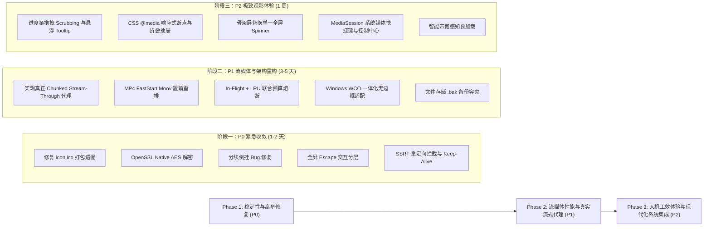

# 🎬 红果开源播放器 (Hongguo Open Player) 全景代码审查与架构健康度综合报告

> **审查对象**：`hongguo-open-player` 最新 `main` 分支代码 (Commit `a5eefda`)  
> **审查周期**：2026-10-28  
> **审查机制**：由 4 位领域专家 Agent（安全、流媒体性能、跨平台架构、UI/UX）并行独立白盒审计与交叉推演  
> **报告总览**：本报告为全方位审查的总览与行动指南，各维度的详细技术分析、POC推演与重构代码请查阅同目录下的子报告。

---

## 1. 总体评价与架构健康度仪表盘 (Executive Dashboard)

经过对底层流媒体解密流水线、本地 Express 回环代理、Electron 桌面跨平台生命周期以及 Vue 3 沉浸式前端界面的全方位审计，**《红果开源播放器》已经具备了非常高水准的工业级 MVP 架构原型**：
- 链路闭环：完成了从免模拟器协议解析、Spade-A 密钥派生、MP4 CENC 实时解密到 9:16 沉浸播放的完整验证；
- 安全意识：具备领先同类开源软件的本地回环隔离（`127.0.0.1` 绑定、DNS Rebinding 防御、Electron 完全沙箱化）；
- 单测与 E2E 完备：包含 14 项离线单元回归测试和 7 项端到端流程验证。

但与此同时，审查也明确揭示了从 **“能跑通的 MVP”** 迈向 **“生产级跨平台商业/精品开源播放器”** 必须攻克的核心架构瓶颈（主要集中在伪流式导致的首帧等待、纯 JS 异或解密 CPU 瓶颈、Windows 平台特异性适配以及前端播放器的人机工效细节）。

### 架构综合健康指数：`79.0 / 100` (等级：B+)

```
┌─────────────────────────────────────────────────────────────────────────────┐
│                       全景健康度雷达 (Four Pillars)                         │
├────────────────────────────┬───────┬──────┬─────────────────────────────────┤
│ 审计维度                   │ 得分  │ 等级 │ 核心现状定性                    │
├────────────────────────────┼───────┼──────┼─────────────────────────────────┤
│ 🛡️ 安全架构与接口防范     │ 91/100│  A-  │ 优秀。回环隔离与权限收敛严密    │
│ 🖥️ 跨平台桌面架构与工程质量│ 82/100│  B+  │ 良好。无原生编译负担，需补 Windows│
│ 🎨 UI/UX 体验与人机工效     │ 75/100│  B+  │ 中上。暗黑氛围好，缺失全屏/进度工效│
│ ⚡ 流媒体性能与解密架构    │ 68/100│  C+  │ 亟需重构。伪流式与纯 JS 解密瓶颈 │
├────────────────────────────┴───────┴──────┴─────────────────────────────────┤
│ 🏆 全局加权综合健康度：79.0 / 100 (生产可用前建议先修复 Critical/High 缺陷)│
└─────────────────────────────────────────────────────────────────────────────┘
```

---

## 2. 缺陷与技术债务矩阵 (Defect Matrix)

全案共识别出缺陷与优化项 **28 项**，按严重程度分布如下：
- **Critical (致命级)**：**5 项**（阻断性体验或严重架构设计缺陷）
- **High (严重级)**：**8 项**（稳定性、兼容性或极端场景隐患）
- **Medium (中度级)**：**10 项**（策略不当、资源浪费或交互不完善）
- **Low / Info (轻度与建议)**：**5 项**（微交互、工程规范与代码气味）

### 🚨 Critical 致命级缺陷清单
| 编号 | 维度 | 缺陷描述 | 潜在后果 |
| :--- | :--- | :--- | :--- |
| **C1** | 流媒体 | **伪流式批处理架构**：必须整集完全下载并解密后才响应首个 Range 请求 | 弱网或 20MB+ 大码率视频下，首帧延迟（TTFB）阻塞长达 15~30 秒，起播体验差 |
| **C2** | 流媒体 | **手写 JS 逐字节异或与 AES-ECB 模拟 CTR** | 单集消耗 >1.4GB 临时 GC 内存，V8 单线程满载阻塞 2.5 秒；相比 OpenSSL 慢 16.8 倍 |
| **C3** | 流媒体 | **并发 Range 分块计算在小文件/边界时存在倒挂 Bug (`start > end`)** | `(concurrency - 1) * chunkSize >= total` 时产生 `bytes=10-8`，引发 CDN 416 报错并全线退化 |
| **C4** | 流媒体 | **飞行中（In-Flight）任务绕过 128MB LRU 缓存预算限制** | 用户快速连续切集时并发拉取多个未完成切片，瞬时内存突破 500MB+，导致 OOM 崩溃 |
| **C5** | 交互体验| **全屏播放状态下按 `Escape` 键直接强退播放器回到目录** | 违背所有视频播放器通用交互期望，全屏观影被意外打断，丢失播放心流 |

### ⚠️ High 严重级缺陷清单
| 编号 | 维度 | 缺陷描述 | 核心风险 |
| :--- | :--- | :--- | :--- |
| **H1** | 跨平台 | **`package.json` 打包白名单漏配 `build/icon.ico`** | 打包后的 Windows 安装版与便携版在运行时无法加载窗口/任务栏图标，回退为 Electron 默认白板 |
| **H2** | 跨平台 | **Windows 标题栏视觉与交互割裂（双标题栏问题）** | 系统外边框与前端顶栏叠加出现双层标题栏，浪费竖屏纵向空间，拖拽手感粗糙 |
| **H3** | 跨平台 | **数据持久化原子写入在 Windows 下存在文件锁（EBUSY）与损坏无备份覆盖** | 并发重命名失败导致进度丢失；单次 JSON 写入异常导致全部历史和收藏被静默抹除 |
| **H4** | 跨平台 | **CI/CD 发布流水线触发策略过度激进** | 每次 push 到 main 均触发全平台打包与正式 Release，极度消耗 Actions 资源并污染发布列表 |
| **H5** | 前端 UX | **播放进度条缺少鼠标滑动拖拽（Scrubbing）与时间预览 Tooltip** | 仅支持粗糙的单次点击跳转，无法进行快速准确定位 |
| **H6** | 前端 UX | **前端 CSS 缺乏 `@media` 响应式媒体查询** | 在 960px 最小窗口尺寸或高分屏缩放下，顶栏 6 个分类药丸与搜索框出现严重排版截断 |
| **H7** | 流媒体 | **缺少 MP4 FastStart 容器重排（Moov 置前）** | 若源文件 `moov` 位于 `mdat` 之后，播放器需反复探测拉取尾部，容易发生黑屏停顿 |
| **H8** | 安全 | **流媒体代理未限制 HTTP 重定向与公网 IP 校验** | Axios 默认跟随 302 重定向，若上游 CDN 存在 Open Redirect 存在潜在 SSRF 盲区穿透 |

---

## 3. Top 5 高投资回报率必修项 (High-ROI Quick Wins)

针对上述清单，以下 5 项改动代码量少（几行到十几行）、风险极低，但能带来**立竿见影的性能与体验质跃**：

### 1. 切换至 Node 原生 OpenSSL `aes-128-ctr`（解密提速 16 倍，解除 CPU 卡死）
- **修改位置**：`src/server/native/hongguo.js`
- **方案**：废弃纯 JS `xorBlock` 手工循环，利用 Node 内置 `crypto.createDecipheriv('aes-128-ctr', key, iv)`，直接对 Buffer 执行 OpenSSL 硬件级解密。
- **效果**：解密耗时由 **2500ms 骤降至 140ms**，单集临时内存占用由 1.4GB 降至零拷贝级别。

### 2. 修复 Range 分块倒挂 Bug 与加入 Keep-Alive Agent 连接池
- **修改位置**：`src/server/services/streamService.js`
- **方案**：
  ```javascript
  // 修正分块终点与起点越界
  const end = Math.min(start + chunkSize - 1, total - 1);
  if (start > end) break; // 避免产生倒挂无效 Range
  ```
  同时为 Axios 注入 `new https.Agent({ keepAlive: true, maxSockets: 32 })`。
- **效果**：彻底杜绝小视频分片 416 报错；8 路并发建连耗时消除 300ms+。

### 3. 打包白名单补齐 Windows 图标与启用 Window Controls Overlay (WCO)
- **修改位置**：`package.json` & `src/electron/main.js`
- **方案**：
  - `package.json` 的 `files` 中补充 `"build/icon.ico"`；
  - Windows 环境启用 `titleBarStyle: 'hidden'`, `titleBarOverlay: { color: '#0f1015', symbolColor: '#ffffff', height: 40 }`。
- **效果**：Windows 窗口图标正常显示，消除 Windows 双标题栏，获得如同 VS Code / Chrome 般的一体化深色沉浸外观。

### 4. 修复全屏状态下 `Escape` 键误退播放器问题
- **修改位置**：`src/client/js/app.js` (`handleKeyDown`)
- **方案**：
  ```javascript
  if (e.key === 'Escape') {
    if (document.fullscreenElement) {
      document.exitFullscreen();
      return;
    }
    closeTheater();
  }
  ```
- **效果**：全屏退出与剧场关闭交互严格分层，彻底消除误退打断观影的致命问题。

### 5. 修复音量滑块解除静音联动与选集已看状态水合
- **修改位置**：`src/client/js/app.js`
- **方案**：调整音量滑块时联动 `videoEl.muted = false`；在加载分集列表时自动根据 `historyStore` 中的进度对比回填 `watched: true`。
- **效果**：基础人机工效与状态记忆闭环。

---

## 4. 三阶段演进实施路线图 (Evolution Roadmap)



---

## 5. 各维度详细审查子报告导航

每位专业审查 Agent 生成的详细技术分析、POC 验证及可直接复制的重构代码已归档至同目录下：

1. **[🛡️ 安全架构与漏洞审计报告](01-security-and-api-review.md)**：包含 DNS Rebinding 防范分析、SSRF 重定向利用推演、Electron 沙箱配置与数据隐私安全性说明；
2. **[⚡ 流媒体性能与解密架构报告](02-streaming-and-media-performance-review.md)**：包含 AES 原生基准测试对比数据、Range 分片算法源码修复、FastStart Moov 算法实现及并发预取优先级队列；
3. **[🖥️ 跨平台桌面架构与工程质量报告](03-cross-platform-architecture-review.md)**：包含 Windows Window Controls Overlay 接入、Windows 文件锁与 `.bak` 备份机制、Electron 优雅退出及 CI/CD 触发策略优化；
4. **[🎨 UI/UX 体验、交互响应与前端质量报告](04-ui-ux-experience-review.md)**：包含进度条 Scrubbing 拖拽算法、CSS 响应式 `@media` 断点方案、选集已看状态水合代码及骨架屏加载动效。
